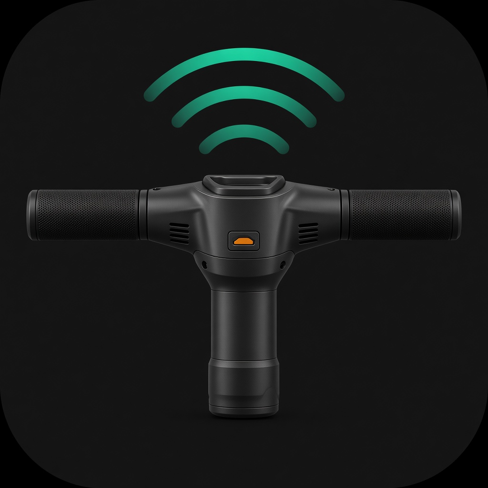
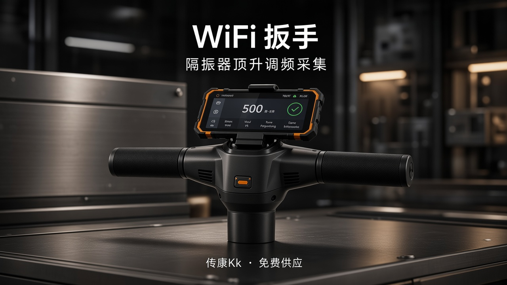
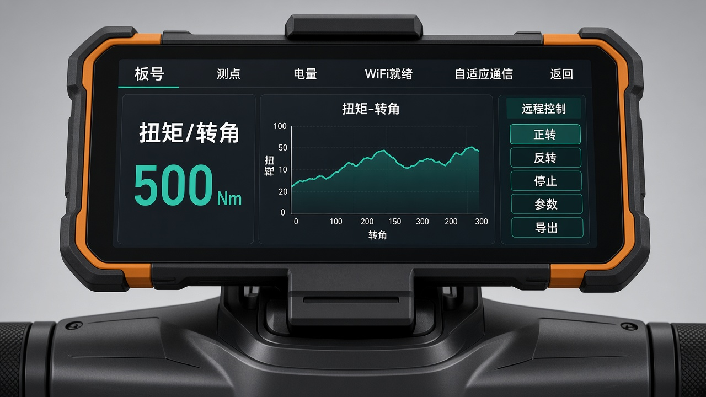

# WiFi 扳手

## 项目背景（先读这里）

**不是开发一把新扳手。** 现场用厂家定制的工业扭矩扳手（Wi‑Fi + TCP/C 协议），对浮置板下大量**钢弹簧隔振器**做顶升测力与**调频**。厂家扳手**给不出可靠「平衡点」**，协议也没有该字段——所以要先把**实时扭矩可视化、远程控制扳手、全量数据与带原生图表的 Excel 导出**做扎实，攒够几百～几千点后，**下一步再做平衡点算法并内嵌**。

更完整的项目背景：[docs/项目背景.md](docs/项目背景.md)  
**UI 设计规范（交接权威，写死）：** [docs/设计规范.md](docs/设计规范.md)（视觉由产品方设计；docs 以文字规范为准）  
二次开发接手：[docs/开发接手说明.md](docs/开发接手说明.md)  
协议实现细节 / Excel / 阶段计划：[docs/界面与导出优化方向.md](docs/界面与导出优化方向.md)  
完整工程约束：[docs/项目背景与开发要求.md](docs/项目背景与开发要求.md)

当前继续 **Kotlin + Jetpack Compose**，仅 Android。本机可不装开发环境，使用 GitHub Actions。

**交付次序：** ① 先交付真实可运行的工人界面（APK）并验收；② 再做贴合实机界面的宣传静帧/动态（见 `docs/项目背景.md`）。

## 权利与供应

- **软件著作权**：本 App 及本仓库原创软件部分归 **传康Kk**（GitHub `1837620622`）所有。厂家扳手硬件与协议原文权利归设备厂家。
- **供应方式**：当前为**免费供应**，不是付费商品或订阅服务；商务变更以著作权人书面说明为准。
- 推送、公开发布或改名商用须经著作权人明确授权。

## 当前状态

功能基线 `b30f0e2` 对应 [Actions build 16](https://github.com/1837620622/wifi-wrench-android/actions/runs/42013640926)：65 项单元测试、API 28/35 仪器测试、Lint、Debug/Release 与签名检查通过。调试包曾用 `0.2.0-debug.1016`。

**2026-11-05：正式工人页已按设计规范实现（代码已写 / 本机编译与单测通过 / 截图自检），尚未用户视觉验收、尚未真机控制验证。** 逐项对照见 [docs/验收对照.md](docs/验收对照.md)：

- 连上扳手 Wi‑Fi 后后台自适应探测（缓存 → 默认 `192.168.4.1:7888` → 候选 → 子网短扫，C 协议握手成功才算并记住）；正式界面无端口/IP。
- 单横屏工作台：顶栏状态 + 返回；左扭矩/转角；中扭矩–转角曲线（按转角跨度自适应）；右远程、正转、反转、停止、参数、导出。
- 远程门闩：未开 0x11 不能正/反转，正/反转二次确认，停止始终可点，结束会话 ≠ 停止扳手。
- 参数侧滑（0x10，确认后写入）；导出 `.xlsx` 含 Excel 原生图表（全量不截断），CSV 在设置里可选。
- App 图标素材与 `docs/design-renders/00-app-icon.jpg` **基本一致**（同构图，分辨率不同）。
- 启动页：**代码叠中文文案**；位图 `wifi_wrench_splash_t_handle.png` **更接近图标**，与 `06-splash.jpg`（手机架在 T 手把上的场景渲染）**不一致**。产品方若要以 06 为定稿，需替换启动页位图或改构图。
- 主台观感按 `01-workbench-hero.jpg` 对齐深色工业分区（左读数 / 中曲线 / 右控制）；仓库里尚无同构图真机截图，仅有概念渲染与合成自检。
- 协议补充：0x05 错误码提示；0x50/0x51 脉冲扳手参数（设置里选扳手类型后开放，默认 0x10）。

算法为数据充足后的 **Phase N+1**。

## 视觉示意（设计渲染）

交互/连接/验收仍以 [docs/设计规范.md](docs/设计规范.md) 为准。下列为 `docs/design-renders/` 示意，便于对照 App 素材是否一致。

| 示意 | 与当前 App 素材 |
| --- | --- |
| 图标 `00-app-icon.jpg` | **一致** → `res/.../ic_launcher_foreground.png` |
| 启动页 `06-splash.jpg` | **不一致**：App 启动位图接近图标构图，中文标题由界面代码绘制 |
| 主台 `01-workbench-hero.jpg` | **分区方向一致**（概念渲染，非实机截图） |
| 宣传短片 `04-promo.mp4` | 氛围片，非功能演示 |

<p align="center">
  
  &nbsp;
  
</p>

<p align="center">
  
</p>

真机外形参照：[docs/reference-hardware/t-handle-on-isolator.png](docs/reference-hardware/t-handle-on-isolator.png)

## 使用与下载

1. 到 Actions 对应 run 的 Artifacts 下载 `app-debug.apk`（不要装 androidTest APK）。
2. 先到系统连接扳手 Wi‑Fi；App **自适应探测** TCP（默认先试 `192.168.4.1:7888`，不通则自动换候选/短扫；正式界面不填、不选端口）。
3. 「测点与记录」页填板号/测点 →「开始测量」；工作台里先开「远程」，再正转/反转（需确认），随时可「停止扳手」。
4. 「导出 Excel」生成带原生图表的 `.xlsx`（全量过程点）；设置里可同时导出 CSV。曲线显示窗口不截断数据库全量。
5. **结束会话 ≠ 停止扳手。** 旧应用勿直接卸载导致丢数据。

## 源码与协议

- `WifiWrenchAndroid/`：Android 工程目录（包名 `com.chuankangkk.wrenchlift`）。根目录 `App3Android` 为兼容旧 CI 的符号链接；Secrets/keyAlias 残留见接手说明；入口 MainActivity → WrenchLiftApp → `ui/worker/WifiWrenchWorkerApp`（DEBUG 可在 设置 → 调试工具 进 BigScreen 控制台）。
- `最新协议.docx`：厂家 C 协议原文（文内标题仍可能带厂家旧称「App3」，仅作协议文本，**产品对外名是「WiFi 扳手」**）。
- `docs/项目背景.md`：**背景第一页（二次开发从这进）**。
- `docs/设计规范.md`：**UI 交接权威**（单屏分区、连接、视觉、协议映射、验收清单）。
- `docs/验收对照.md`：实现方按验收清单逐项自检（证据与未验证项分开写）。
- `docs/design-renders/`：产品方设计稿落位目录（可空）；**非**规范正文；**禁止**塞 AI 软件概念图当定稿。
- `docs/reference-hardware/`：T 形手把真机参照（非 UI 稿）。
- `docs/开发接手说明.md`：模块、禁忌、无硬件测试、**待改名清单**。
- `docs/界面与导出优化方向.md`：锁定决策 + 功能码表 + 阶段。
- `docs/项目背景与开发要求.md`：长约束。
- `AGENTS.md`：Agent 执行规则。
- `.github/workflows/android.yml`、`tools/`：CI 与校验脚本。

仓库只保留软件、授权协议与必要说明；禁止 CAD、真实库、密钥等入库。

仓库地址：https://github.com/1837620622/wifi-wrench-android

## 构建规则

Java 21 + 工程内 Gradle wrapper + Android SDK（CI 安装）。可选本地：

```shell
cd WifiWrenchAndroid
./gradlew testDebugUnitTest lintDebug assembleDebug assembleDebugAndroidTest assembleRelease
```

版本基线 0.2.0；CI `versionCode=1000+run_number`。调试签名由 Secrets 提供。推送/发布需用户明确授权。
