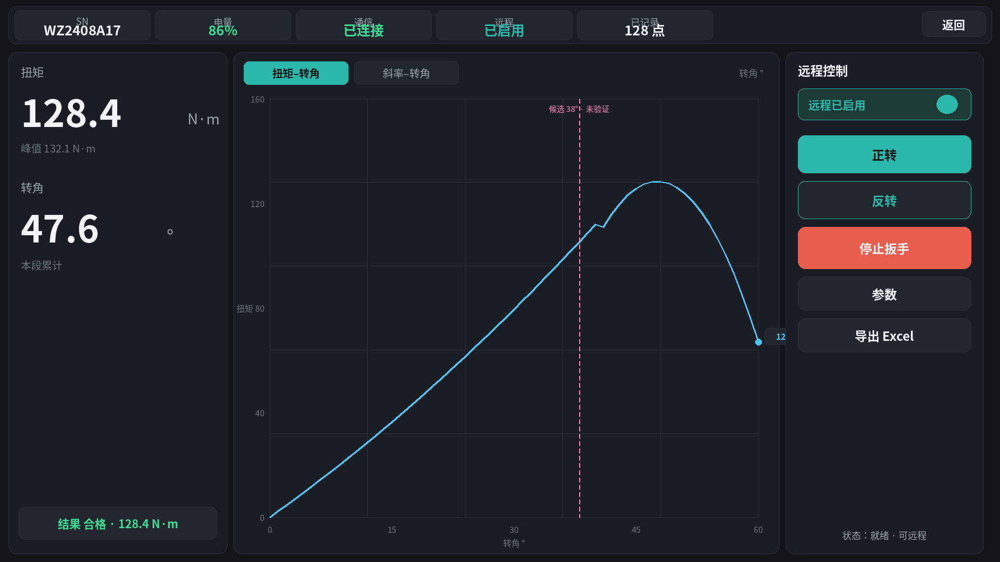
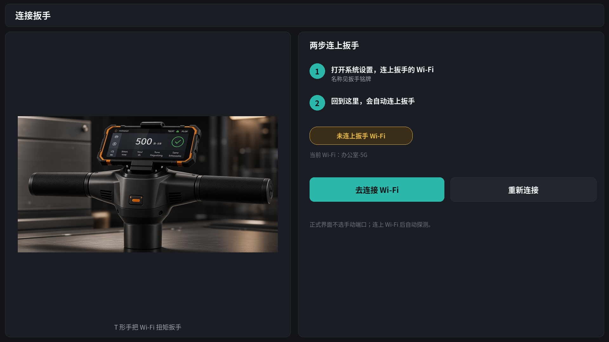
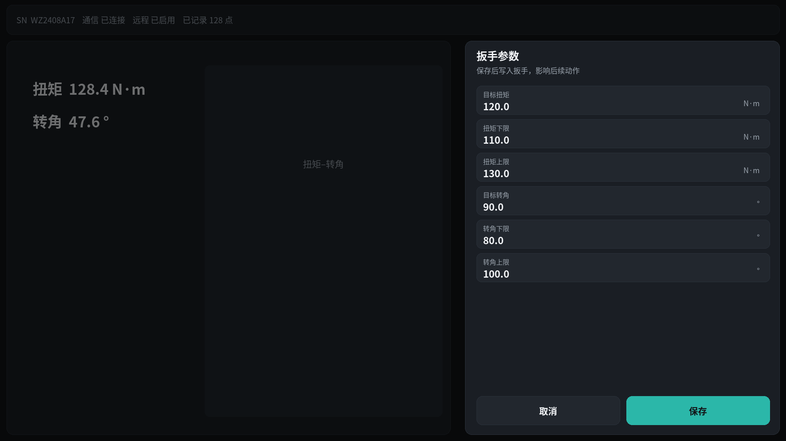

# WiFi 扳手

## 项目背景（先读这里）

**不是开发一把新扳手。** 现场用厂家定制的工业扭矩扳手（Wi‑Fi + TCP/C 协议），对浮置板下大量**钢弹簧隔振器**做顶升测力与**调频**。厂家扳手**给不出可靠「平衡点」**，协议也没有该字段——所以要先把**实时扭矩可视化、远程控制扳手、全量数据与带原生图表的 Excel 导出**做扎实，攒够几百～几千点后，**下一步再做平衡点算法并内嵌**。

更完整的项目背景：[docs/项目背景.md](docs/项目背景.md)  
**UI 设计规范（交接权威，写死）：** [docs/设计规范.md](docs/设计规范.md)（视觉由产品方设计；docs 以文字规范为准）  
二次开发接手：[docs/开发接手说明.md](docs/开发接手说明.md)  
协议实现细节 / Excel / 阶段计划：[docs/界面与导出优化方向.md](docs/界面与导出优化方向.md)  
完整工程约束：[docs/项目背景与开发要求.md](docs/项目背景与开发要求.md)

当前继续 **Kotlin + Jetpack Compose**，仅 Android。本机可不装开发环境，使用 GitHub Actions。

**交付次序：** ① 先交付真实可运行的工人界面（APK）并验收；② 再做贴合实机界面的宣传静帧/动态（见 `docs/项目背景.md`）。

## 权利与供应

- **软件著作权**：本 App 及本仓库原创软件部分归 **传康Kk**（GitHub `1837620622`）所有。厂家扳手硬件与协议原文权利归设备厂家。
- **供应方式**：当前为**免费供应**，不是付费商品或订阅服务；商务变更以著作权人书面说明为准。
- 推送、公开发布或改名商用须经著作权人明确授权。

## 当前状态

**版本基线 0.3.0（build 36，第五轮）**：标签 [`v0.3.0-build36`](https://github.com/1837620622/wifi-wrench-android/tree/v0.3.0-build36)，安装包在 [Actions](https://github.com/1837620622/wifi-wrench-android/actions/workflows/android.yml?query=branch%3Amain) 对应 build 36 的 Artifacts `wifi-wrench-debug-36`。上一份 Release：[v0.3.0-build32](https://github.com/1837620622/wifi-wrench-android/releases/tag/v0.3.0-build32)。尚未用户视觉验收、尚未真机控制验证；转折候选算法未经标定与实测验证。

历史基线：功能基线 `b30f0e2` 对应 [Actions build 16](https://github.com/1837620622/wifi-wrench-android/actions/runs/42013640926)。

**2026-11-05：正式工人页已按设计规范实现（代码已写 / 本机编译与单测通过 / 截图自检），尚未用户视觉验收、尚未真机控制验证。** 逐项对照见 [docs/验收对照.md](docs/验收对照.md)：

- 连上扳手 Wi‑Fi 后后台自适应探测（缓存 → 默认 `192.168.4.1:7888` → 候选 → 子网短扫，C 协议握手成功才算并记住）；正式界面无端口/IP。
- 单横屏工作台：顶栏状态 + 返回；左扭矩/转角；中扭矩–转角曲线（按转角跨度自适应）；右远程、正转、反转、停止、参数、导出。
- 远程门闩：未开 0x11 不能正/反转，正/反转二次确认，停止始终可点，结束会话 ≠ 停止扳手。
- 参数侧滑（0x10，确认后写入）；导出 `.xlsx` 含 Excel 原生图表（全量不截断），CSV 在设置里可选。
- App 图标素材与 `res/.../ic_launcher_foreground.png`（T 手把 + Wi‑Fi）一致；示意见 `docs/reference-hardware/`。
- 启动页：直接使用定稿场景位图（`wifi_wrench_splash_scene.jpg`，示意 `docs/design-renders/03-splash.png`），文案已在图内、代码不再叠字 → **一致**。连接引导用 T 手把产品图，已无套筒扳手图。
- 主台示意见 `docs/design-renders/01-workbench.png`（深色工业分区：左读数 / 中扭矩–转角 / 右远程控制，无端口/无板号）；交互以设计规范为准，尚非真机截图。
- 协议补充：0x05 错误码提示；0x50/0x51 脉冲扳手参数（设置里选扳手类型后开放，默认 0x10）。

**2026-11-06 第三轮（单台扳手 / 去废话 / 排版与导出自检）**：代码已写、本机编译与单测通过、截图自检；尚未用户视觉验收、尚未真机控制验证。

- 只有一台扳手：主流程不再有板号/测点，连上 Wi‑Fi 直接测量；记录按「R{记录号} · 开始时间」区分。
- 主屏去掉底栏与说明句（「显示窗口 / 完整数据见导出」「分离：待分析」等）；作者只在「设置 → 关于」。
- 主图页签（第四轮改为扭矩–转角 / 斜率–转角，见下），本段亮、上一段灰，末点标签自动避让曲线，坐标轴平滑伸缩。
- 窄屏与 1.3 倍字体下页签、按钮、SN 不再出省略号或吞字；平板整体放大；设置页与参数侧滑在 640×360 一屏放下。
- 导出：接收时间精确到毫秒（修复旧版最多约 ±4ms 偏差）；概要加峰值扭矩、峰值处转角、转角范围、运行段数。
- 启动页沿用用户定稿位图；图内页脚仍有「传康Kk · 免费供应」（是否换图待用户定）。

**2026-11-06 第五轮复查**：断线后自动重连现在**续用同一条记录**（曲线保留；10 秒以内的空档标为「数据间断」，更长的切成新运行段）；只有「结束会话」后再连接，或换了一台扳手，才新开记录。写参数时不再写入编造的员工号等标识。修正了斜率轴标签小数位错误、界面序号与导出不一致的问题。详见 [验收对照.md](docs/验收对照.md) §5.1。

**2026-11-06 第五轮（协议吃透 / 工况 / 通信记录）**：0x15 的 M1/M2 字段分开（M2 的 28-29 是预设扭矩实际值，不再当目标扭矩）；新增工况划分（空程、加载、停转保压、卸载、转动降扭、脱开空转、回退、空转）与疑似打滑 / 转角回退 / 数据间断事件；导出新增「工况分段」「工况事件」「结果帧」「通信记录」，原生图 10 张；主屏只在图表页签右侧显示当前段末点工况。代码已写、本机全量单测与构建通过；尚未用户视觉验收、尚未真机控制验证；工况阈值为开发默认值，待真机数据标定。

**2026-11-06 第四轮（协议核对 / 平衡点研究图 / 详细导出）**：代码已写、本机编译与单测通过（160 余项）、截图与导出渲染自检；尚未用户视觉验收、尚未真机控制验证；**算法只是候选，未标定、未验证**。

- 协议逐条核对：0x15 收到即回 0x17（保证 0.5 s 内）；0x06 NAK 只归到 3 s 内刚发的指令；0x15 汇总值不再并入实时曲线；解析缓冲不丢帧；0x10 下限 ≤ 上限；实时图与导出同一运行段切分。docx 自身 3 处不一致已列出待厂家确认。详见 [docs/界面与导出优化方向.md](docs/界面与导出优化方向.md) §2.1。
- 去掉「扭矩–序号」「转角–序号」：序号只是接收先后编号，不是物理量，找平衡点用不上。
- 屏幕只放与平衡点直接相关的两张图：**扭矩–转角**（叠加「候选 x° · 未验证」：紫色竖线 + 菱形 + 两段拟合虚线）和 **斜率–转角**（局部 dT/dθ，转折处是台阶）。数据间断（段内 > 2.5 s 无数据）用虚线 + 小圆 +「间断 N s」，与候选区分。
- 标签互相避让，矮屏 / 1.3 倍字体下不重叠、不吞字。
- 导出更详细：新增「工况分段」「工况事件」「结果帧」「通信记录」「拟合明细」「候选扫描」；「运行段」加平均转速、单直线斜率、最佳两段位置、工况次序与判读；「过程数据」加运行段、帧号、帧内序号、段内时间/转角、相对有效加载起点转角、帧间转速、接收间隔、工况、事件；原生图 10 张（扭矩–转角、斜率–转角、各段叠加、残差改善–候选位置、扭矩/转角/转速/帧接收间隔–接收时间，以及按工况着色的扭矩–转角、扭矩–接收时间）+ 结果扭矩对照。
- 协议 0x15：M2 模式下 28-29 是「预设扭矩实际值」，不再当目标扭矩显示或回填参数；结果帧字段名按 M1/M2 分开导出。
- 工况（开发默认阈值，待真机标定）：空程、加载、停转保压、卸载、转动降扭、脱开空转、回退、空转；事件：疑似打滑（扭矩骤降且转角仍增）、转角回退、数据间断。屏幕只在主图右上角显示当前段末点工况，明细在导出。

找平衡点的思路（候选，待验证）：在每段**有效加载**（去空行程、去卸载）的扭矩–转角曲线上找**斜率突变**的位置——原支承接触面分离时，力的传递路径变了，曲线斜率随之变化。用两段直线与单直线比残差，改善明显、前后斜率差别够大才给候选；否则写「未识别」及原因。阈值要用真实数据 + 独立力值/间隙参考试验来定，导出里的「拟合明细」「候选扫描」就是为此准备的。

## 视觉示意（软件界面图）

交互/连接/验收仍以 [docs/设计规范.md](docs/设计规范.md) 为准。下列为 `docs/design-renders/` 按规范色板与真代码文案渲的工人界面软件图（非真机截图）。

| 示意 | 说明 |
| --- | --- |
| 主台 `01-workbench.png` | 顶栏状态 + 左读数 + 中扭矩–转角 + 右远程控制（无端口/无板号） |
| 连接引导 `02-connect-guide.png` | 左 T 手把，右两步连 Wi‑Fi（无端口栏） |
| 启动页 `03-splash.png` | 定稿场景示意 → 运行时 `res/drawable-nodpi/wifi_wrench_splash_scene.jpg` |
| 参数侧滑 `04-params-sheet.png` | 目标扭矩等字段 + 保存写入 |

<p align="center">
  
</p>

<p align="center">
  
</p>

<p align="center">
  
  &nbsp;
  
</p>

真机外形参照：[docs/reference-hardware/t-handle-on-isolator.png](docs/reference-hardware/t-handle-on-isolator.png)

## 使用与下载

1. 最新：GitHub [Actions](https://github.com/1837620622/wifi-wrench-android/actions/workflows/android.yml?query=branch%3Amain) 里 build 36 的 Artifacts `wifi-wrench-debug-36`（不要装 androidTest APK）；标签 `v0.3.0-build36`。上一份正式包：[v0.3.0-build32](https://github.com/1837620622/wifi-wrench-android/releases/tag/v0.3.0-build32) 的 `WiFi-Wrench-0.3.0-build32-debug.apk`（可用同页 SHA256 校验）。
2. 先到系统连接扳手 Wi‑Fi；App **自适应探测** TCP（默认先试 `192.168.4.1:7888`，不通则自动换候选/短扫；正式界面不填、不选端口）。
3. 只有一台扳手，连上 Wi‑Fi 直接进工作台（「记录」页点「开始测量」也行，无需填表）；先开「远程」，再正转/反转（需确认），随时可「停止扳手」。主图可切「扭矩–转角 / 斜率–转角」；紫色「候选 · 未验证」只是转折候选，不是平衡点。
4. 「导出 Excel」生成带原生图表的 `.xlsx`（`WifiWrench_R{记录号}_{开始时间}.xlsx`）：概要 / 图表（10 张原生图）/ 运行段 / 工况分段 / 工况事件 / 结果帧 / 拟合明细 / 候选扫描 / 通信记录 / 过程数据（全量 + 派生列，接收时间精确到毫秒）/ 图表数据；设置里可同时导出 CSV（原始备份）。
5. **结束会话 ≠ 停止扳手。** 旧应用勿直接卸载导致丢数据。

## 源码与协议

- `WifiWrenchAndroid/`：Android 工程目录（包名 `com.chuankangkk.wrenchlift`）。入口 MainActivity → WrenchLiftApp → `ui/worker/WifiWrenchWorkerApp`（DEBUG 可在 设置 → 调试工具 进 BigScreen 控制台）。
- `最新协议.docx`：厂家 C 协议原文（文内标题可能仍用厂家旧称，仅作协议文本，**勿改 docx**；**产品对外名是「WiFi 扳手」**）。
- `docs/项目背景.md`：**背景第一页（二次开发从这进）**。
- `docs/设计规范.md`：**UI 交接权威**（单屏分区、连接、视觉、协议映射、验收清单）。
- `docs/验收对照.md`：实现方按验收清单逐项自检（证据与未验证项分开写）。
- `docs/design-renders/`：按设计规范/真代码文案渲的工人界面软件图；**非**规范正文；交互仍以设计规范为准。
- `docs/reference-hardware/`：T 形手把真机参照（非 UI 稿）。
- `docs/开发接手说明.md`：模块、禁忌、无硬件测试。
- `docs/界面与导出优化方向.md`：锁定决策 + 功能码表 + 阶段。
- `docs/项目背景与开发要求.md`：长约束。
- `AGENTS.md`：Agent 执行规则。
- `.github/workflows/android.yml`、`tools/`：CI 与校验脚本。

仓库只保留软件、授权协议与必要说明；禁止 CAD、真实库、密钥等入库。

仓库地址：https://github.com/1837620622/wifi-wrench-android

## 构建规则

Java 21 + 工程内 Gradle wrapper + Android SDK（CI 安装）。可选本地：

```shell
cd WifiWrenchAndroid
./gradlew testDebugUnitTest lintDebug assembleDebug assembleDebugAndroidTest assembleRelease
```

版本基线 0.3.0；CI `versionCode=1000+run_number`。调试签名由 `WIFI_WRENCH_DEBUG_*` Secrets 提供。推送/发布需用户明确授权。
