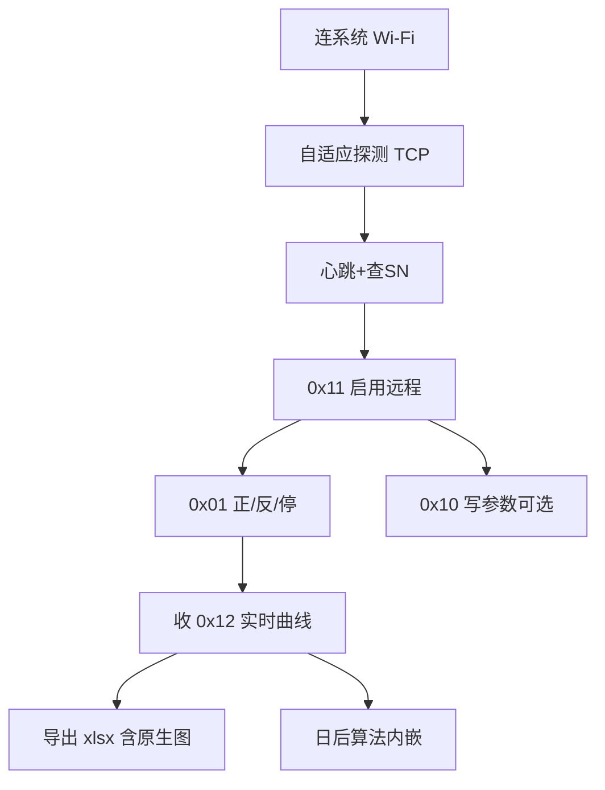

## 连接交互（已锁定）

连上扳手 Wi‑Fi 后 **自适应探测** TCP 端点：默认先试 `192.168.4.1:7888`；若设备改了端口/主机，则自动换候选并短扫扳手子网，直到 C 协议握手成功，并记住上次成功端点。正式 UI **不展示、不要求工人选择端口**；主界面直接远程使能与正转/反转/停止及实时曲线。host:port 仅高级诊断可查看/编辑。其它工作流不变。权威细则：`设计规范.md` §3。

# WiFi 扳手：界面、远程控制与导出优化方向（重大更新方案）

> 状态：文档交接版；**产品 Kotlin 大改仍冻结**，待用户下一批意见后再动代码。  
> 背景白话见 [项目背景.md](项目背景.md)；工程接手见 [开发接手说明.md](开发接手说明.md)。  
> **UI 布局/视觉/验收写死见 [设计规范.md](设计规范.md)**（本文保留协议表与阶段；与设计规范冲突时 UI 条款以设计规范为准）。  
> 协议依据：`最新协议.docx` + `protocol/` + `connection/` + `MeasurementViewModel` 控制写路径（已对照多轮）。

---

## 0. 背景必须反复对齐的三句话

1. App 服务的是**隔振器顶升/调频现场**：很多隔振器、多测点；扳手是**厂家定制设备**，本仓只做手机软件。  
2. 厂家**给不出可靠平衡点**；协议也没有平衡点字段。现在要：**实时扭矩可视化 + Wi‑Fi/TCP 后按协议彻底远程控制 + 带原生图的 Excel 全量导出**，攒几百～几千点。  
3. **平衡点/分离算法 = 数据够了之后的下一阶段**，再内嵌；现在禁止伪造成「已确认平衡」。

---

## 1. 目标与非目标

### 目标

1. 工业气质 + Mac/iOS 顺滑；默认横屏；**主工作台单屏无纵向滚动**。  
2. Wi‑Fi 优先，再 **自适应探测** TCP；连上后可读实时过程，并可**正式界面远程控制**（非永远藏调试）。  
3. 实时扭矩–转角真正可读；显示窗口按**转角跨度自适应**。  
4. 导出 **xlsx 为主、内嵌原生 Excel 图表**；设置可选 CSV。  
5. 协议忠实；无硬件时用金样例/Mock **多轮测试**。

### 非目标

- 不以宣传渲染/概念动态代替真实 UI 验收；宣传片不做逐功能生硬导览。
- 不造扳手硬件、不改 C 协议帧格式、不做 Windows 本阶段。  
- 不输出未验证平衡点/正式力值（未标定）。  
- 正式 UI 无模拟采集；不以 CI 绿代替视觉/控制安全验收。  
- 「断开 App / 结束采集」≠ 机械已停；运动指令必须确认。

### 已锁定决策（用户卡片）

| 项 | 锁定 |
| --- | --- |
| Excel 图 | **原生 Excel 图表优先** |
| 控制布局 | **实现方定**横屏工业手机方案（见 §3） |
| 实时窗口 | **按转角跨度自适应** |
| 导出 | **xlsx 主**；设置可选 CSV |
| 代码大改 | **本轮不做**；先文档交接 |
| 交付次序 | **先真实 UI APK**，再高端宣传静帧/动态（贴合实机，非功能流水账）；文档阶段不产渲染/视频 |

---

## 2. 协议深读：功能码总表

帧：`C5 C5 | 地址 | 功能 | 保留2B | 长度 | 数据 | 累加和`（亦识别 `A5 A5`）。

图例：方向 **↑** 扳手→App，**↓** App→扳手。  
实现：✅ 已有组包/解码并在链路使用；◐ 有能力但 UI/流程不完整；❌ 未实现组包或未接入。

| 码 | 方向 | 用途摘要 | 缩放/要点 | 实现 | 正式 UI？ |
| --- | --- | --- | --- | --- | --- |
| 0x11 | ↓ | 启用/停止**远程控制**（0x01=开，0x00=关） | 启停 0x01 **依赖先开远程** | ✅ Builder+VM | **要进正式**（安全） |
| 0x01 | ↓ | 停止/正转/反转 | 须已 0x11；示例与金测一致 | ✅ | **要进正式**（确认框） |
| 0x06 | ↑ | ACK/NAK | 1 字节；**不带「应答哪条指令」** | ✅ 解码；NAK 只归到 3 s 内刚发的控制指令 | 状态提示 |
| 0x10 | ↓ | M1/M2 **参数写入**（80B） | **角度写入×10**；扭矩 u16 整数；保留字节协议写作「反退角」现固定 FF FF | ✅ | 正式「参数」层+强确认 |
| 0x12 | ↑ | **每秒扭矩角度过程**（多点） | 扭矩/角示例为**整数** Nm/°；无逐点设备时戳 | ✅ 解码+入库 | **主可视化** |
| 0x15 | ↑ | 运行结束结果 | 状态在 reservedHigh；扭矩角字段说明书未写÷10 | ✅；收后**先回 0x17 再入库**（不排在数据库写入后面）；结果值不并入实时曲线 | 结果条/导出 |
| 0x17 | ↓ | 确认已收 0x15（0.5s 内） | 未确认则结果留在扳手侧 | ✅ 自动 | 无需工人点 |
| 0x04 | ↑ | 电量 % | 0–100 | ✅ | 顶栏可显示 |
| 0x05 | ↑ | 状态（原文偏控制器→屏） | 错误码+控制位含方向 bit | ✅ 摘要日志 | 可升格状态灯 |
| 0x21 | ↑ | 请求对时 | | ✅ 自动回 0x22 | 自动 |
| 0x22 | ↓ | 对时 | 年月日时分秒 | ✅ | 自动 |
| 0x33 | ↓ | 心跳防自动关机 | 宜约 1 分钟 | ✅ TCP 内循环+手动 | 后台 |
| 0x25/0x26 | ↓/↑ | 查/答 SN（BCD） | 连接探测已发 0x25 | ✅ | 顶栏 SN |
| 0x23 | ↑ | 螺母计数复位选项 | | ✅ 解码日志 | 低优先 |
| 0x44 | ↑ | GPS | | ✅ 日志 | 本阶段非主 |
| 0x50/0x51 | ↓ | 脉冲/离合/冲击参数 | 扭矩 0–65535→0–6553.5 | ✅ Builder（2026-11-05） | 设置选脉冲扳手后开放 |
| 0x55 | ↑ | 脉冲类结果 | **扭矩÷10** | ✅ 解码 | 若设备走脉冲 |

### 远程控制结论（对「连上 Wi‑Fi 就能彻底控制」）

协议路径是：

`系统 Wi‑Fi → 自适应探测 TCP（先 192.168.4.1:7888，再候选/短扫，握手成功则缓存）→（建议）心跳+查 SN → 0x11 启用远程 → 0x01 正/反/停 → 可选 0x10 写参 → 持续收 0x12 / 电量 / 状态 → 结束时 0x01 停 → 可关远程 → 断开`。

**缺口（2026-11-05 状态见末尾「实现状态」；第 1–3、6 条已在正式工人页实现，第 4 条仍待机型确认）：**

1. 正式 `WorkerWorkbench` **没有**远程/正反转/停止/写参——只在 DEBUG `ConnectionPanel`。  
2. 连接成功**不会**自动 0x11；工人若只点「连接并采集」并不能转动扳手。  
3. 无「远程已启用」持久状态机/门闩（未开远程仍可瞎发 0x01，设备侧应忽略，App 侧易误导）。  
4. 0x50/0x51 脉冲参数未实现——若定制机是常规扭矩模式，0x10 为主；需用户确认机型。  
5. 「彻底控制」≠ 改厂家固件；以 C 协议已列指令为上限。  
6. 软件停止采集 **不会**自动发 0x01 STOP——安全文案与一键「停扳手」要分开做。

### 其它协议风险（UI/导出）

- 0x12 同帧多点共享接收时间；时间轴图必须标明。  
- 0x15 与 0x55 扭矩缩放可能不同；真机对照屏显。  
- `recentPoints` 现 `takeLast(50)`；与「转角跨度自适应」目标不符，改代码时再动。  
- `buildCsv(state)` 若误用会只出窗口点；全量导出必须走 DB 分页思想。

### 2.1 协议逐条核对（2026-11-06 第四轮，对照 `最新协议.docx`）

已改（均有单测）：

| # | 问题 | 原实现 | 现实现 | 单测 |
| --- | --- | --- | --- | --- |
| 1 | 0x15 须 0.5 s 内回 0x17，否则扳手自存结果 | 回 0x17 排在同一把锁里的数据库写入之后，库忙时可能超时 | 收包协程里校验通过**立刻回 0x17**，再进锁入库 | `resultFrameIsAckedRightAwayAndStaysOffTheLiveCurve` |
| 2 | 0x06 不说明应答哪条指令 | 任何 NAK 都算到「最后一条控制指令」头上（可能是几分钟前的） | 只归到 3 s 内刚发的控制指令；否则只记日志 | `nakIsOnlyAttributedToARecentCommand` |
| 3 | 0x15 结果帧的扭矩/转角是汇总值，不是过程点 | 并入实时曲线，曲线末尾跳一下 | 只入库、刷新读数与导出「过程数据」（帧类型列可区分），不进曲线/统计/候选 | 同 #1；导出 `runsSheetListsCandidatePerRunAndChartOverlaysThem` |
| 4 | 解析缓冲上限 | 解析前截断，一次读到大块数据时可能丢掉其中完整帧 | 先解析完再按「最大帧长 − 1」保留尾部（半帧不丢、垃圾有上限） | `largeChunkOverBufferLimitKeepsEveryFrame`、`garbageIsCappedButFollowingSplitFrameSurvives` |
| 5 | 0x10 上下限 | 未校验下限 ≤ 上限 | 两者都非 0 时要求下限 ≤ 上限（协议：0 = 不判） | `parameterLimitsMustBeOrderedUnlessZero` |
| 6 | 运行段切分 | 实时图与导出口径不同 | 共用 `TorqueAngleWindow.isNewRun`：螺栓号变化、转角回落 > 45°、从 ≥ 5° 回到 ≤ 1°、> 10 s 无过程帧 | `shortRunFollowedByRestartFromZeroIsSplit` |
| 7 | 0x12 一帧多点 | 逐点单独写库 | 一帧一次批量写入（同一事务） | 既有入库/导出测试 |

#### 2.2 第五轮：吃透 0x15 / 工况（2026-11-06，代码与导出已改，待真机核对）

| # | 项 | 原问题 | 修复 | 证据 |
|---|----|--------|------|------|
| 1 | 0x15 M2 字段 | M2 的 28-29 是「预设扭矩实际值」，却当目标扭矩显示、回填参数、画目标线 | M2 不再当设定值；字段名按参数模式给出（M1：目标扭矩 / 目标扭矩实际值；M2：预设扭矩实际值 / 最终扭矩实际值；角度字段 M2 为目标角度设置值 / 实际值）；只有 M1 的 28-29 作为设定扭矩回填 | `ResultFrameModeTest`、导出「结果帧」M2 行 |
| 2 | 0x15 状态与模式 | 状态码只显示中文，模式只写数字 | 结果帧表保存状态码（0x13 = 疑似打滑 等）与模式文字；未定义模式写「模式 0x..（协议未定义）」，不猜 | `unknownModeIsLabelledNotGuessed` |
| 3 | 0x55 模式 | 模式码未解释 | 0x00 RC283F 扭矩 / 0x01 定点硬连接 / 0x02 定点软连接 / 0x03 RCH MP 任意参数 | `PulseResultFrameDecoder.modeLabel` |
| 4 | 通信记录 | 应答、状态、对时等只在界面日志里，无法追溯 | 新表 `frame_events`（数据库第 4 版，只增表）：收发的非 0x12 帧逐条入库，导出「通信记录」 | 迁移 3→4；导出测试 |
| 5 | 工况 | 「空程 / 空转 / 停转 / 回退 / 打滑 / 卸载」未区分 | 新增 `WorkingCondition`：按前后各 3 点的转角与扭矩变化分段；打滑要求扭矩骤降且转角仍增加（卸载时扭矩降、转角停住，不算打滑） | `WorkingConditionTest`（9 项） |

工况判定（开发默认阈值，待真机标定；只描述现象，不下故障结论）：空程（未受力且在转，尚未受力）→ 有效加载起点；脱开空转（受力后未受力仍转）；加载（受力且在转）；转动降扭（在转且扭矩明显降）；停转保压（受力不转）；卸载（不转且扭矩降）；回退（转角在减）；空转（整段峰值 < 5 N·m）。疑似打滑、转角回退、数据间断逐条列入「工况事件」。

屏幕只在主图页签右侧显示当前段末点工况（「加载」「停转保压 · 打滑 n」等），矮屏放不下时隐藏；明细全部在导出。

核对无误、保持不变：帧头/累加和；0x12 长度 12 + 4n、转角为整数度不缩放；0x10 角度 ×10、M1 目标角度 00 00、「反退角」保留字节固定 FF FF；0x55 扭矩 ÷10；0x11 先于 0x01；0x33 心跳；0x21→0x22 对时。

协议文本自身的不一致（以字节布局为准，待厂家确认）：

- 0x10 示例 2 文字写上限 400，字节却是 `01 F4`（= 500）。
- 0x15 示例状态字节为 `FF`，与正文状态码表不符。
- 0x06 没有被应答指令字段，只能按时间就近归属（见 #2）。

---

## 3. 单横屏信息架构（含安全控制）

实现方选定布局（锁定：代理决定）。推荐工业横屏分区如下——**主区无竖滚**：

```text
┌─────────────────────────────────────────────────────────────────────────┐
│ A 顶栏：SN · 电量 · 通信 · 远程 · 已记录点数 · 返回（单台扳手，无板号/测点）│
├────────────┬──────────────────────────────────────────┬─────────────────┤
│ B 读数柱    │ C 主图：页签 扭矩–转角 / 斜率–转角          │ D 控制柱         │
│ 扭矩 大号   │ 轴名/单位/游标；本段亮、上一段灰            │ [远程控制]       │
│ 峰值        │ 自适应窗口（按转角跨度），不写说明句        │ 状态行（反馈/报错）│
│ 转角 大号   │                                          │ [正转] [反转]    │
│ 新鲜度/结果 │                                          │ [停止扳手] 强调  │
│             │                                          │ [参数] [导出]    │
└────────────┴──────────────────────────────────────────┴─────────────────┘
（2026-11-06 第三轮：去掉底栏；入库点数进顶栏，「结束会话≠停扳手」留在返回确认框。）
```

安全规则：

- **正转/反转**：二次确认；未启用远程时按钮禁用并提示先 0x11。  
- **停止扳手**：最大触控、无需藏在菜单；与「结束采集」并排但颜色/文案不同。  
- **写参数**：独立确认，提示会改变设备动作阈值。  
- 设置/历史/详细参数用抽屉，避免主台竖滚。



---

## 4. 视觉与实时图

- 浅中性 + 克制强调色；少粗按钮墙。  
- 主图高度优先；大字体不裁切读数。  
- **实时**：扭矩–转角主系列；新鲜度（≠心跳）。  
- **窗口**：按转角跨度自适应保留形态（可辅以桶抽样保极值）；主屏不写「显示窗口 / 全量在导出」类说明句，库与导出始终全量。  
- **后置**：游标、分段、Excel 全图；候选分离仅标记为未确认。

---

## 5. Excel 导出

- **主路径**：Apache POI XSSF → 真 `.xlsx` + **原生图**。  
- **设置**：可选同时/仅 CSV。  
- 数据表全量过程点；图可用降采样系列，表不砍行。  
- **屏幕 vs 导出（2026-11-06 第四轮锁定）**：屏幕只放和找平衡点直接相关的两张图（扭矩–转角、斜率–转角）；导出尽量详细，既方便调试软件，也方便离线做算法分析。
- **导出图（10 张 + 有结果帧时结果扭矩对照）**：
  1. 扭矩–转角（叠加转折候选紫色菱形，未验证）；
  2. 斜率–转角（局部 dT/dθ，转折处是台阶）；
  3. 各段叠加：扭矩–有效转角（对齐有效加载起点，最近 8 段；看重复试验转折位置稳不稳）；
  4. 残差改善–候选位置（两段直线 vs 单直线；峰尖而高 = 转折明确，红虚线 = 判定阈值 50%）；
  5. 扭矩–接收时间、6. 转角–接收时间（手机接收时基）；
  7. 转速–接收时间（帧间 °/s，看是否低速连续加载）；
  8. 帧接收间隔–接收时间（段内 ms，查通信卡顿/丢帧）；
  9. 扭矩–转角（按工况着色）、10. 扭矩–接收时间（按工况着色）：空程 / 加载 / 停转保压 / 卸载 / 转动降扭 / 脱开空转 / 回退 / 空转，颜色分开；另有普通扭矩–接收时间图（不着色）。
- **导出表**：概要（含工况汇总与结果帧字段，M1/M2 字段名分开写）；运行段（每段点数、时长、转角范围、平均转速、峰值、有效加载起止、单直线斜率、最佳两段位置与残差改善、候选与判定/未识别原因、工况次序与各阶段转角、停转保压时长、打滑/回退/间断次数、判读）；工况分段（每段阶段、起止序号与时间、转角与扭矩变化、平均转速）；工况事件（疑似打滑、数据间断、转角回退逐条，带位置与数值）；结果帧（每个 0x15/0x55 逐字段解出，M1/M2 字段名、状态码、所属运行段的 0x12 峰值与最大转角）；拟合明细；候选扫描；通信记录（收发的非 0x12 帧：应答、状态、对时、电量、SN、结果、确认、控制指令，逐条带原始 HEX）；过程数据（全量 + 派生列：距上一点、运行段、段内时间、帧号、帧内序号、帧内点数、段内转角增量、相对有效加载起点转角、帧间转速、工况、事件）；图表数据。
- 去掉：扭矩–序号、转角–序号（「序号」只是接收先后编号，不是物理量；需要时「过程数据」序号列可自行作图）。
- **有条件**：扭矩–力（仅标定后）。

---

## 6. 无硬件测试计划（多做几轮）

| 轮次 | 内容 | 现状 |
| --- | --- | --- |
| A | Builder 金样例：0x11/0x01/0x10/0x17/0x25/0x33 | ✅ 已有 |
| B | 0x12 docx 示例逐点解码断言 | 需补强 |
| C | 0x15/0x55 缩放分测 | 部分有 |
| D | Parser 粘包/半包/坏校验/`A5A5` | 部分有 |
| E | 收 0x15 必发 0x17 | 需单测固化 |
| F | Mock TCP：连接探测→多帧 0x12→结果→点数=导出行 | 建议新增 |
| G | 远程门闩：未 0x11 时 UI/VM 拒绝或警告 0x01 | 待做（改代码阶段） |
| H | 角度：0x10×10 vs 0x12 整数 不混用 | 建议专项 |

禁止：把测试合成流接到正式运行采集入口。

---

## 7. 修订后的阶段计划

| 阶段 | 内容 | APK/证据 |
| --- | --- | --- |
| **0** | 文档与决策冻结（本轮） | 本目录 Markdown |
| **1** | 单屏壳 + 视觉 + Wi‑Fi 流 | 无竖滚、读数不裁切 |
| **2** | 正式**安全控制柱**（远程/正反/停/参数）+ 状态灯 | 未开远程无法误触运动；文案分离 |
| **3** | 实时主图可读 + **转角跨度自适应窗口** | 大字体主图可辨 |
| **4** | **xlsx + 原生图**全量导出（设置可选 CSV） | 离线打开即见图 |
| **5** | 真机协议缩放/长采/控制时序验收 | 读数≈屏；控制可靠 |
| **N+1** | 平衡点/分离**算法**研发与内嵌 | 另立需求；数据量门槛先定 |
| **宣传** | 仅在对应 UI 阶段**验收通过后** | 高端静帧 + 营销向动态，画面=实机 UI；非本阶段产物 |

依赖：`0→1→2→3→4`；`5` 有硬件即插；`N+1` 在大量导出数据之后。**宣传物料排在已验收 UI 之后**，不得与阶段 1–4 并行倒逼设计。

---

## 8. 仍需真机 / 用户确认

1. 定制扳手是常规 0x10/0x12/0x15，还是还要 0x50/0x51/0x55？  
2. 0x15 扭矩是否与 0x12 同一整数刻度？  
3. ~~连接后是否默认自动 0x11~~ **已锁定：正式界面保留「远程控制开关」（工人点 0x11）；不自动偷偷开启。连 Wi‑Fi/TCP 自动，远程使能显式。**  
4. 正转在现场对应顶升方向是否与协议「正转」一致？  
5. 单次试验期望点数量级（决定自适应窗口与 Excel 图降采样）。

---

## 8.5 实现状态（2026-11-05）

| 项 | 状态 |
| --- | --- |
| 阶段 1 单屏壳 + 视觉 + Wi‑Fi 流 | 代码已写 · 单测/截图自检通过 · 待用户视觉验收 |
| 阶段 2 安全控制柱（远程/正反/停/参数） | 代码已写 · ViewModel 级 TCP 时序单测通过 · 待真机 |
| 阶段 3 主图 + 转角跨度自适应窗口 | 代码已写 · 单测通过（`TorqueAngleWindowTest`） |
| 阶段 4 xlsx + 原生图（设置可选 CSV） | 代码已写 · POI 读回 + LibreOffice 渲染自检 · 待手机端 Excel/WPS 确认 |
| 阶段 5 真机缩放/长采/控制时序 | 未开始（需硬件） |
| 测试缺口 B/E/F/G | E（0x15→0x17）、F（脚本 TCP 扳手→入库→导出）、G（远程门闩）已补；B（docx 0x12 逐点）未补 |
| 0x50/0x51 | 组包 + 单测已做；设置「扳手类型」选脉冲扳手才开放（默认 0x10）；RCH 设定扭矩缩放待真机 |
| 0x05 | 错误码/控制位已解析，错误码非 0 工人可见；位序待真机 |
| 观感 | 第二轮按产品方 T 手把工业手机渲染重做（默认深色、分格顶栏、青绿大读数、渐变主图、远程控制表头条）；待用户视觉验收 |
| 第四轮（2026-11-06）协议核对 | 见 §2.1：7 处已改并有单测；docx 自身 3 处不一致待厂家确认 |
| 第四轮 转折候选 / 斜率图 | 代码已写 · 单测/截图自检通过 · **阈值为开发默认值，未经试验标定；算法未经实测验证，不是平衡点** |
| 第四轮 详细导出 | 代码已写 · POI 读回 + LibreOffice 渲染自检 · 待手机端 Excel/WPS 确认 |

逐项证据：[验收对照.md](验收对照.md)。

## 9. 文档索引

| 文件 | 角色 |
| --- | --- |
| [项目背景.md](项目背景.md) | 为什么做（第一页） |
| [设计规范.md](设计规范.md) | **UI 交接权威（写死）** |
| [design-renders/](design-renders/) | 产品方设计稿落位（可空）；权威仍是设计规范 |
| [开发接手说明.md](开发接手说明.md) | 怎么接、禁忌、测试 |
| [验收对照.md](验收对照.md) | 正式工人页按验收清单的自检证据与未验证项 |
| 本文 | 协议表、实现缺口、Excel、阶段（UI 分区细节以设计规范为准） |
| [项目背景与开发要求.md](项目背景与开发要求.md) | 长约束与验收 |
| 根 `README.md` / `AGENTS.md` | 入口与 Agent 规则 |
